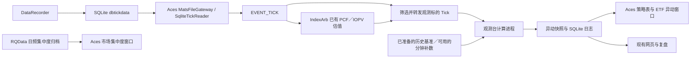

# Aces IndexArb 接入 ETF 异动与市场集中度开发方案

> 设计稿。2026-11-26 核对 IndexArb `dev_home`（HEAD `dd46eda`，含本地在研改动）、Aces 打包入口 `63cf51b4` 和观测台 `8e0fdbe`。生产采用 SQLite 行情模式，以用户确认的生产部署为准。开发时以目标发布分支的实际接口为准。

生产基线已由用户确认，Aces 使用 `MatsFileGateway` 的 SQLite 行情模式，Tick 字段完整且行情链路可用。监控模块消费现有标准行情事件。开发验收聚焦新增监控逻辑、模式切换及 UI 行为。

**2026-11-26 迁移边界确认：本轮只调整迁移方案。FtShare 当前源码、业务配置、日初生成脚本和现有归档保持原状。下文的待补齐事项属于后续 Aces / IndexArb 目标侧开发与验收要求，不要求先改造当前 FtShare 项目。** 既有日初脚本作为已交付的准备工具和数据格式参考，其面向 Aces 的加载与口径适配按第 5 节执行。

## 1. 交付范围

在 IndexArb 的「基差期限结构」右侧并排增加「ETF异动监控」「市场集中度监控」，打开两个独立非模态窗口。**两个窗口分别完整承载 FtShare 的 ETF 资金观测台和市场拥挤度观测台。** 窗口标题沿用交易员指定名称，窗口内包含原 Web 的全部区域、图表、明细、参数、日期和数据源选择、说明及缺数反馈。布局调整服从全量功能对等要求。

策略页保留「关联ETF最新异动」作为定位入口，点击后打开 ETF 监控窗口并定位相关标的。指标公式、确认规则、数据源和回放归属沿用当前业务实现，Qt 前端读取统一结果。迁移验收逐项对照下表，并使用同一输入核对两端的值、缺失状态和选择结果。

### IndexArb 运行环境适配

实时行情由 IndexArb 当前 Gateway 统一提供。生产链路为 DataRecorder 写 SQLite，`MatsFileGateway / SqliteTickReader` 发布 `EVENT_TICK`。页面头部显示 Gateway 名称、SQLite 来源、行情时间和延迟。Gateway 连接及 SQLite 路径沿用 Aces 既有连接与配置入口，监控窗口读取当前生效来源。IOPV 使用 IndexArb PCF 估值，同时展示来源、估值时点与覆盖率。

日频以配置指定的归档数据包或 DDB 查询适配器提供。配置保存路径、来源、字段映射和标的范围，日频数值保存在数据文件或数据库。IndexArb 现有 `daily_factor_file` 对应分红和基差因子，新增 ETF 和市场监控归档应有独立路径及结构，分别校验。

独立日初生成已实现：`scripts/prepare-monitor-preopen.py` 按 `config/monitor-preopen.json` 查询现有 DDB 表，生成逐日 `monitor-preopen.json`，包含 20／60 日成交额中位数、分钟和秒级基准、指数辅助参考、历史最后交易日 ETF 数据与归档清单。准备查询严格早于目标日，不依赖目标日已产生行情；不写 `daily_factors.json`。现有脚本的 `as_of` 来自已观察到的历史日期，Aces 目标侧还需核对其是否为应用预期的 T-1，并按第 5 节核对分钟边界兼容性。详细字段、命令、覆盖和退出码见[监控日初准备](../operations/monitor-preopen.md)。Aces 引擎自动加载与 Qt 状态展示在接入阶段实现。

| 监控数据 | 适配来源与启动行为 |
|---|---|
| ETF／指数／期货 Tick | 当前 Gateway 及已有行情订阅，按统一标的映射消费。 |
| IOPV | 当前 IndexArb PCF 实时估值。PCF 来源可以是文件或已配置 DDB。 |
| 日频 ETF 价格、份额、净值、折算、净申赎与宽基统计 | 配置指向归档文件或 DDB 适配器。页面读取发布日期、交易日和覆盖。归档更新由后台准备流程完成。 |
| 20／60 日分钟基准与秒级基准 | 配置指定基准目录，按目标日、版本、标的和分位数核验，后台补齐。 |
| 集中度、大小盘、行业、公募、融资与宏观 | 配置指定各模块归档及来源，分别保存日期与覆盖状态。IndexArb 的策略成分及实时行情与全市场数据覆盖分别检查。 |
| 主动成交与净申赎对照、异动回放和日志 | 配置指定对照快照、回放和日志目录，按原口径读取。 |

窗口内保留原来的数据来源与状态说明功能，展示改成「实时 Gateway」「日频归档」和「观测数据配置」。数据配置入口可复用参数管理界面，拟增加观测数据目录及模块文件映射。此入口是新增设计。日频归档选择展示当前数据包及其原始供应商，接口就绪状态独立于 Gateway 状态。全市场或季度数据不足时使用原缺数状态。

**Aces 默认选择 Tick，并提供界面上的 Tick／Bar 切换。** 当前代码已支持 `minute_driver="tick"`，由 Gateway Tick 累计成交额差分聚合本地分钟，送入同一个正式检测器。既有 1／2／5／10 分钟窗口、P75、确认等级和累计金额口径沿用原实现。30／60 秒持续放量为提前候选，需要兼容的历史秒级基准。当前仓库默认配置仍为 `provider`，与 Aces 目标配置分别记录。

Tick 主驱动可以在没有供应商实时 Bar 的情况下完成正常分钟的正式确认。供应商 Bar 可用于历史基准、对账和缺口补齐，原恢复路径可继续使用；无可用补数输入时，缺口保留并标明，补数来源和覆盖可追溯。接入验收使用同一回放核对事件、金额和完整性，并记录真实 SQLite 链路延迟。

### 用户切换正式驱动

ETF 监控窗口上方提供「正式监控驱动」下拉和「应用切换」，旁边常驻显示实际生效模式与切换状态。模式对该监控引擎内所有 ETF 统一生效，策略页异动列与独立窗口保持一致。界面显示 Tick／Bar，内部映射为 `tick`／`provider`。市场集中度日频窗口按自己的归档更新。

Tick 和 Bar 两种模式共用现有 `MatsFileGateway` 行情。Tick 模式逐 Tick 更新聚合器和候选，封闭分钟继续使用既有正式窗口规则。Bar 模式消费同一行情在统一聚合层形成的完整分钟 Bar，按完整 Bar 推进正式检测器。已有标准分钟归档也可用于回放和重建。界面选择监控计算的驱动方式，Gateway 连接独立管理。内部 `provider` 名称沿用现有 Bar 分支的配置值，Aces 中的实际分钟来源随归档记录。

按「应用切换」后，通过现有命令链路串行处理该次请求，返回请求编号、目标模式、实际模式和结果。界面在处理中禁用重复应用。目标配置准备失败时，保留原模式和原有结果，并显示失败原因。只有成功切换才保存默认模式供后续启动使用。

当前 `PushSession` 禁止同交易日跨驱动覆盖原归档，动态切换需要新增会话编排。为目标驱动创建独立目录和日志，加载兼容基准，按统一截止时点重建当日已完成数据并追平切换期间的输入，再发布新会话快照。每份快照携带模式、会话和切换时点。历史确认信号按原会话保存，新会话的当日累计独立计算。切换结果重建和实时追平过程使用可追溯的去重键，历史重建不触发实时播报，切换到新会话后仅通知新的状态变化。

无足够历史输入时切换失败并明确显示缺数原因，原监控继续运行。切换流程需覆盖 Tick→Bar、Bar→Tick、重复请求、目标不可用、切换期间新行情、失败恢复、断线及日切。秒级候选、IOPV 和期货 Tick 证据的输入状态单独展示，正式 Bar 驱动时可继续生成具有完整 Tick 输入与基准的候选。

HTML 原型已提供交互切换和 Bar 输入不可用的演示。真实命令处理、目标会话重建及模式持久化在 Aces 开发阶段实现。

## 2. 全量 HTML 原型与 Qt 映射

[打开完整 HTML 原型](../assets/mockups/aces-monitors.html)。文件可直接用 Chrome 或 Edge 打开，全部内嵌资源，行情和资金数据为演示样本。顶栏切换两个窗口，各自可通过「独立窗口」打开单独页面。

ETF 原型直接使用当前 `src/index.html`、`dashboard.js`、`radar.js` 和相关计算辅助代码。市场原型按 `src/crowding.html` 的全部区域和控件重建中文模板，使用当前 `crowding.js`，原模板中部分标签存在编码异常。两个页面完整保留现有 DOM 标识，图表继续用同一 ECharts 交互，展示外壳作桌面化调整。后续迁移至 Qt 时按完整功能清单验收。

用项目 Python 环境运行 `python scripts/build-aces-prototype.py` 可从当前前端源码重新生成原型。构建器使用公开演示快照及合成样本，检查两个原页面的 DOM 标识覆盖。生成文件内嵌全部脚本、图表库和演示 API。页面顶部始终标明演示数据，日志入口显示演示记录。

本机 Chrome 已验证九张 ETF 图、事件分钟明细图、八张市场图、主动成交对照、宽基视图切换、事件选择、期货字段、行业与融资筛选、集中度档位、独立窗口及紧凑布局，未检测到 JavaScript 异常。Qt 前端迁移后需按本节清单重做对应验收。

### Qt 原生交互版布局

当前 HTML 用桌面页签展示全量内容。ETF 窗口使用「概览与异动」「盘中交易」「放量信号」「日度资金」四页，市场窗口使用「成交额集中度」「大小盘风格」「指数行业」「公募重仓」「融资与估值」五页。每个页签只显示自己的区域，保留区域内部的表格和图表。顶部有紧凑概览、数据源与正式驱动设置，使用「定位图表」下拉跳转到所属页并定位图表。图表区域可调整高度，表格单独滚动。原来的图表导航和页面区域都映射到可访问的页签内容。

| 原型交互 | Qt 实现与验收重点 |
|---|---|
| 两个独立窗口 | `QDialog` 非模态窗口，复用 `show_dialog()`。再次点击激活并恢复最小化，关闭后释放自身监听和定时器。 |
| 四页／五页布局 | `QTabWidget`，每页用 `QVBoxLayout`、`QGroupBox`，内容较多时放进 `QScrollArea`。切页只更新显示，回到页签立即补刷最后快照。 |
| 状态、数据源、Tick／Bar 设置 | `QLabel`、`QComboBox` 和 `QPushButton`，实际模式与处理状态用文字显示。命令异步返回后更新，Qt 主线程保持可操作。 |
| 筛选、日期和回放时点 | `QComboBox`、`QDateEdit`、`QTimeEdit`、`QSlider`，保留原范围、边界、选择保持和回放时钟语义。 |
| 事件、资金、期货及缺数表 | 沿用 IndexArb `OptimizedMonitor` 与现有单元格类型，较大历史明细使用 `QTableView / QAbstractTableModel`。列排序按原始数值，行身份按标的／事件键。 |
| 列显隐和拖动排序 | 复用显示管理与 `QHeaderView` 列移动，字段键用于保存布局和分派双击行为。 |
| 多图、拆分高度与并排区域 | 使用已安装的 PyQtGraph，外层 `QSplitter` 调整区域大小。折线、柱状、参考线和双／多轴分别映射 `PlotDataItem`、`BarGraphItem`、`InfiniteLine` 与关联 `ViewBox`。 |
| 图例、悬停和区间选择 | 图例控制系列显隐，自定义光标和悬浮提示，`LinearRegionItem` 或 `ViewBox` 选择区间。沿用同一数据和统计函数，核对原缩放、刷选和区间结果。 |
| 说明、日志和播报 | 折叠说明用 `QToolButton` 加可折叠区域，长日志用独立 `QDialog / QPlainTextEdit` 或表格。播报接入现有 Aces 提醒服务，字体和主题沿用 Aces。 |

HTML 中的图表依旧由 ECharts 绘制，用于验证内容与操作。Qt 图表需按上表实现，重点对账多坐标轴、图例、悬浮与区间统计。视觉尺寸以系统缩放和字体度量为准，在 100%／150% 缩放、小屏和多屏环境验收表格与工具栏。

### 工具栏和窗口行为

```text
行情网关 […] [刷新合约] [基差期限结构] [ETF异动监控] [市场集中度监控] [连接 DDB]
```

两个入口均使用 `IndexArbManager.create_gateway_bar()` 加按钮，对照 `open_basis_dialog()` 与 `show_dialog()`，各分配一个窗口键。窗口支持同时打开、激活已有实例、恢复最小化、移动至副屏、最大化和关闭。窗口关闭释放其定时器和监听，计算继续。内容按业务页签组织，使用图表定位下拉与页内滚动，各明细表独立横向滚动。主题、字段顺序和显隐、选择状态按现有框架持久化。

### ETF异动监控完整清单

| Web 区域 | 必须呈现的内容与交互 | Qt 映射 |
|---|---|---|
| 页头、数据源、状态与概览 | 日频／实时源独立选择，数据源状态与字段说明、主题切换、行情新鲜度，核心 ETF 成交额、宽基最新净流入、本年累计、追踪覆盖。 | 顶部来源栏、状态栏、概览卡片和说明对话框。 |
| 篮子异动雷达 | 累计成交额，20／60 日同进度倍数，近 5 分钟双基准，上证涨跌，回放滑块与跟随最新，阈值和样本说明。 | 雷达分区及原参数控件，保持同一计算结果。 |
| 指数与单只 ETF 盘中集中交易 | 指数当日确认放量／方向／期货对冲预估，单只事件全部字段，拖动排序与列显隐，实时／回放日期、时点，所有期货金额口径和分期限证据，所选事件分钟成交与基准图。 | 指数汇总表、事件表、字段设置、明细图与合约详情。 |
| 候选、通知、归档与对账 | 分钟内 Tick 候选、秒级持续性候选，语音启用／音色／语速／音调／音量／试听，去重成交额、正超额、日末申赎、量级比，正式日志、期货分类日志及 Tick／供应商分钟对账。 | 状态区、播报设置、金额卡片、日志和对账视图。 |
| 单只 ETF 日度资金信号 | 20 只 ETF 的行情与净申赎、阈值分类、日期与计数、展开全部。 | 卡片或逐标的表格，保留原内容和展开能力。 |
| 盘中分钟观测 | 分钟成交与上证综指 `chart`、累计对比 `chartCum` 与日期选择、放量日分钟结构 `chartTypCase`、常态日分钟结构 `chartTypNorm`，实时 ETF 行情表，来源与字段。 | 四图、表格、日期和来源说明分区。 |
| ETF 放量信号 | 放量日成交额 `chartAmt`、放量日净申购 `chartNf` 及对应数据来源。 | 两图与说明分区。 |
| 日度历史资金 | 日成交额 `chartDAmt`、日净申购与指数 `chartDNf`，范围和来源。 | 两图与时间筛选。 |
| 主动成交与净申赎对照 | 起止日期、跟随最新、ETF 与数据状态筛选，主动买／主动卖／净申赎／差额、配对覆盖，每日明细／标的汇总／日期汇总和分页。 | 筛选栏与三视图表格。 |
| 宽基资金全景 | `chartBroad`，申赎表／合计／规模／折溢价，自定义起止日、年度、类别、全部日期／最近完整段，覆盖与累计说明、缺数原因、区间日度表及展开、单只 ETF 折溢价明细。 | 四视图共用筛选和图表，配套明细与缺口表。 |
| 公共交互 | 图表导航、分区收起展开、图例显隐、悬停、缩放与范围选择、许可和数据口径。 | Qt 原生交互实现并逐项核对。 |

策略表扩展继续落在 `EtfRow`、`EtfMonitor` 和 `update_etf_table()`，按交易所与 ETF 标的匹配事件。正式分钟事件与秒级候选分别呈现。数值缺失、旧日期和断连状态沿用 Web 语义。最新命中、峰值窗口和期货观测窗口各标识其时间。

### 市场集中度监控完整清单

| Web 区域 | 必须呈现的内容与交互 | Qt 映射 |
|---|---|---|
| 页头和概览 | 前 1% 成交占比与历史分位、沪深 300／中证 1000 总市值比和成交额比，快照范围、覆盖和日期，主题、导航。 | 顶部四卡和独立日频状态。 |
| A 股成交额集中度 | 前 1%／3%／5% 档位、指数叠加，`marketConcentrationChart`，日度明细、入选股数、金额、占比、分位、成交／停牌／缺数和计算说明。 | 集中度页和明细表。 |
| 大小盘风格 | `marketCapitalChart`、`marketTurnoverChart`，市值比均值及 ±1σ／±2σ，成分和缺数口径。 | 两图与统计参考线。 |
| 指数行业拥挤度 | 沪深 300／中证 500、行业市值／成交额、第一行业／指定行业选择，`marketIndustryChart`，行业覆盖、分类版本与峰值。 | 指数和行业控件、图和覆盖状态。 |
| 公募重仓集中度 | 每季第一行业／指定行业，`marketFundChart`，报告期、披露日期、基金覆盖及持仓口径。 | 季度图与来源说明。 |
| 融资与市场估值 | 指数叠加，融资余额与近 20 日日均净增 `marketBalanceChart`，同比及融资／市值／流通市值／M2 `marketLeverageChart`，市值／GDP `marketValuationChart`，住户存款 Wind 占位及公布日口径。 | 三图、独立坐标轴、缺项占位和口径。 |
| 范围和公共交互 | 原图表近 20／60／125／250／750／1250／2500 交易日、表格近 5／20／60／125／250 日，分区显隐、图例、悬停、缩放，子模块加载状态与重试。 | 各窗口独立控制，沿用当前接口的范围参数。 |

两个窗口包含全部区域。Qt 可以用内部页签或滚动分区安置这些内容，入口保留在各自窗口。日期范围和数据齐备程度由现有接口决定。原型内没有真实行情权限调用，语音控件依赖浏览器所提供的音色，日志为演示记录。

## 3. 数据流与读写边界



首阶段使用 `GET /api/etf-burst` 验证读取、映射和界面。接口的 `date`、`replay`、`symbols`、`events`、`baseline_as_of`、`baseline_ready`、`updated_at`、`minute_coverage` 是首版读入点。按 `updated_at` 去除重复快照，由一个后台读取器统一缓存。默认目标刷新约 1 秒，连接超时与重试在后台处理，任一时刻只保留一个在途读取。Qt 通过 Signal 更新可见控件。后续需要推送可使用已有 `/api/etf-burst/stream`。[HTTP API](../reference/http-api.md)

市场窗口按原 Web 逻辑分别读取集中度、行业、公募、融资归档，保留四个接口独立的日期和覆盖状态。窗口打开、区间切换和日频刷新各读取相应快照。两个窗口独立处理加载、空数据、断连和更新时间。

接入共享 Tick 后，事件回调只筛选源及标的、复制字段并尝试入队。耗时计算、远程访问和落库由观测台进程完成。采用有限长度队列，容量或链路异常时记录缺口并显示降级，回补通过原有行情恢复流程完成。只注册一次通用 `EVENT_TICK`。同一标的使用明确的行情源，换源或累计值回退时重新建锚，差分不跨数据源或交易日。旁路读取和转发随应用引擎生命周期退出，窗口拆装不重新注册订阅。

### 生产 SQLite 接入方式

`vnpy_datarecorder/engine.py` 按 `vt_symbol` 记录 Tick，通过后台线程批量写入 `vnpy_sqlite/sqlite_database.py` 的 `dbtickdata`。Aces 的 `MatsFileGateway` 在 SQLite 模式启动现有 `SqliteTickReader`，按已订阅标的将标准 Tick 发布到 `EVENT_TICK`。观测台通过 Aces 转发消费同一批 Tick。已在 DataRecorder 落库且已被 Aces 订阅的标的可以直接复用。新增 ETF、指数或期货期限时，分别检查记录配置与 Aces 订阅覆盖。`vnpy_indexarb/recording.py` 的 `build_recording_plan()` 已按策略生成股票、ETF、指数和期货 Tick 清单，可作为核对入口。ETF 本地分钟由这些 Tick 在观测计算侧聚合。

生产 Tick 已包含累计 `volume`、`turnover`、市场 `open_interest` 与盘口。监控消费时保留这些字段及来源、时间和已有可用性标记。期货 Reader 已通过 `indexarb_futures_flow` 附带成交量、持仓量可用标记及启动快照标记。累计差分在启动补发或重连时以快照建锚，遇到重置或换源重新建锚。实盘和回放使用各自的输出目录。

SQLite 到达速度由写入、读取和发布共同决定。当前 DataRecorder 源码默认每 10 个 Timer 事件入写队列，vn.py 默认 Timer 为 1 秒。Reader 默认 `sqlite_poll_ms=50`，只决定已提交数据被读到的间隔。从行情时间到实际 UI 更新可能还需等待写队列、数据库提交、事件积压和前端合并刷新。验收需在生产设置下，分别观察 ETF、期货的记录间隔、批量提交到 Aces 的延迟与端到端 P50／P95。`localtime` 只有确认来自上游真实接收时刻时才用于拆分时延，只有 Reader 观测时间时按其实际语义记录。

### 行情与估值接口

下列为开发契约。字段名按现有对象及序列化协议落地，时间统一保存带时区的时间戳，交易日按 `Asia/Shanghai`。

| 数据 | 来源和所需字段 | 缺失时的行为 |
|---|---|---|
| ETF Tick | Aces 网关，`vt_symbol`、`gateway_name`、行情时间、可用的真实接收时间、最新价、累计成交量、累计成交额、买一／卖一。 | 价格和盘口仍可展示。缺累计额时，受影响的窗口标记缺口，可用分钟补数按原恢复路径处理。缺盘口时按现有方向判定规则保留无法判向的成交。 |
| 指数行情 | 关联 ETF 所跟踪的指数价格，按交易所和标的代码精确映射。 | 缺指数数据只影响指数证据。 |
| PCF IOPV | 读取 `EtfData.iopv`、`pcf_coverage`、`iopv_source`，在估值发布点记录交易日、估值时点和行情覆盖状态。 | 未加载当日 PCF 或覆盖低于 IndexArb 现行配置时传空值。多个策略引用同一只 ETF 时，定义一份明确的有效估值来源，不使用最后写入覆盖。 |
| 期货 Tick | 具体挂牌合约、产品与期限、乘数、累计成交量与成交额、买卖一、最新价、市场 `open_interest` 和时间。 | 可展示已覆盖合约，缺合约时完整汇总留空。现有 `FuturesEvidence.add()` 要求市场 `open_interest` 等基础字段有效，缺失时该合约无法生成同窗证据。 |

IOPV 复用 IndexArb 的计算和覆盖门槛。IndexArb 原折溢价使用最新成交价，雷达证据继续使用买卖一中点除以同一 IOPV。观测端按估值时点检查时效，数值不变时沿用正常的时效判定。回放只使用窗口时点已经可见的估值，缺当时的 PCF IOPV 记录时留空或使用单独标明的历史供应商来源。开发入口为 `engine.py` 的 PCF 更新路径及 `base.py` 的 `EtfData`。

使用现有生产 Tick 样本验收新增监控的首报、级别、窗口金额、期货同窗以及 Tick／Bar 模式切换的回放一致性。

### 期货窗口与账户持仓

沿用项目的 ETF 跟踪指数到合约产品映射，沪深 300 对 `IF`，上证 50 对 `IH`，中证 500 对 `IC`，中证 1000 对 `IM`。每天确定实际挂牌的四期限合约，按具体合约统计；缺少订阅覆盖时先显示已有合约。取与 ETF **同一个确认窗口**的期货 Tick，并使用现有 `FuturesEvidence`。期货结果可能后到，按事件 ID 与窗口分别合并到原行。指标下拉提供主动卖／主动买估算、净增仓名义额、卖侧增仓代理额，并支持查看合约覆盖和贡献。

- 市场增仓使用行情 `open_interest` 的窗口端点差，名义额按现有参考价与合约乘数换算。主动成交方向依据现有盘口估算，结果保留未分类成交和覆盖提示。
- IndexArb `futures_flow.py` 已消费 SQLite 期货行情，提供固定滚动窗的成交方向、持仓变化和换月候选。可以并列展示对应时间和合约，为交易员提供上下文。ETF 同窗需要按确认事件的起止时间重算金额，固定滚动窗结果无法直接填入同窗列。
- IndexArb 的组合／账户持仓、成交和 PnL 可以作为独立的交易员视图展示。`PositionData`、MATS 组合持仓及账户的持仓变动与市场 `open_interest` 使用各自口径。市场指标用于判断同步性和量级，不能由它推断交易主体或真实套保仓位。
- 多 ETF 异动若引用同一合约的重叠窗口，逐事件可各自展示，跨 ETF 汇总须按合约和时间去重。明细时间以各指标实算窗口标识，期货窗口与 ETF 峰值窗口不一致时并列标明。 [现有期货指标口径](../reference/tick-driver.md#股指期货同窗观测)

## 4. 开发顺序与验收

| 阶段 | 改动 | 验收 |
|---|---|---|
| 0. 目标侧契约与交接准备 | 固定实施分支和版本，确认第 5 节的职责、数据接口、分钟边界、T-1 校验、归档目录及验收样本。此阶段只形成方案和交接材料。 | 每项要求均有目标侧实现归属与验收条件，当前 FtShare 源码及配置保持原状。 |
| 1. 界面与只读接入 | 工具栏两个并列按钮、两个独立窗口、`EtfRow` 字段与策略表快捷入口。逐项迁移第 2 节所有区域，分别用与 Web 相同的 JSON 样本驱动界面。 | 三个工具栏窗口可同时使用，分别关闭和重开；重复点击只激活已有窗口。策略列双击正确定位；原基差编辑和字段设置可用。沪深同代码正确区分，九张 ETF 原图、事件明细图、八张市场原图、全部表格及参数按清单验收，单个接口不可用时其余界面仍可操作。 |
| 2. 共用行情和 IOPV | 接入 Aces 的只读 Tick 转发和 PCF 估值，采用 `minute_driver="tick"` 的正式驱动，期货使用已验证覆盖的共享行情。 | 同一份分钟和基准下，原路径与新路径的正式信号、窗口和 ETF 成交额一致。逐只对齐 IOPV 与估值时间。期货四期限覆盖齐备时分合约及汇总对账。用盘口缺失、累计回退、合约换月、乱序、断流补数样本检验。 |
| 3. 发布与盘中验收 | 在 Aces 目标包启用。比较接入前后的启动和盘中负载，保留独立的功能开关。 | 记录首笔报价、放量就绪、IOPV 达标的时间，以及事件分发 P95、队列积压、CPU、内存和 UI 刷新。基准或观测服务不可用时，验证现有策略、基差、持仓、盈亏与订单工作流可用。 |

日初分开管理行情、分钟基准、秒级基准和 IOPV 就绪。历史基准由观测台提前生成，依据目标交易日、前一交易日、标的、规则版本和分位数匹配。冷启动缺基准时后台准备，原日初组合初始化不等待历史查询。收盘归档和历史回放继续写观测台现有目录，支持指定交易日的 RQData／DDB 回放。 [单日复盘命令](../operations/runbook.md#34-单日-etf-异动复盘)

界面回归可参考 IndexArb 对「基差期限结构」的子窗口复用、关窗释放测试，并沿用 `tests/diagnostic_ui_boot_smoke.py` 的字段显隐案例。观测口径回归可沿用本仓库 `tests/test_tick_live.py` 与 `tests/test_futures_evidence.py` 的样本，再用相同交易日离线回放核对两端结果。Aces 仍需用目标发布包做真实桌面和盘中运行检查。

2026-11-26 用本地测试数据运行 IndexArb `test_optimization.ReaderTests`、`test_recording` 和 `test_futures_flow`，44 项通过，覆盖字段映射、补发与续读、记录配置和期货监控。生产库的字段覆盖、单位及端到端延迟仍需盘中采样。

首版建议先验证一只策略内 ETF 和一组股指期货合约，再扩到获授权的观测标的池。切换共享输入前，保持老输入可单独启用。切换时按明确交易日或隔离输出目录运行，避免同一实时归档同时接收两条行情输入。关闭接入开关后，确认新界面及读端退出，IndexArb 原流程和观测台独立运行可恢复。

## 5. 迁移目标侧的开发与验收要求

本节承接迁移前 review。以下差异用于定义 Aces 接入要求；本轮不修改 FtShare 的生成器、实时采集器、前端计算或数据文件，也不修改 IndexArb 源码。

### 5.1 职责与实现位置

| 部分 | 后续目标侧职责 |
|---|---|
| IndexArb UI 与接入层 | 新增两个独立 Qt 窗口和策略表入口；复用当前 Gateway Tick、合约及 PCF IOPV；提供参数、模式切换、状态、提醒和窗口生命周期。事件回调只转发必要数据，Qt 主线程只处理展示。 |
| 独立监控计算层 | 按原迁移方案在后台计算进程中运行，提供与行情供应商解耦的入口，复用既有检测、金额与期货同窗算法；实时和回放共用相同计算路径。由 IndexArb 接入工作配套实现，避免在 Qt 控件中重复计算。 |
| 目标侧日初适配与历史数据准备 | 加载独立的监控 JSON，校验交易日、标的、分位数、规则及边界版本；必要时按目标侧口径重算基准。实现可放在 Aces 配套准备模块，现有 FtShare 脚本继续保持原状。 |

### 5.2 分钟边界兼容性

现有 DDB 历史聚合使用分钟结束后 5 秒内的累计值；当前 `TickMinutes` 的 `provider-v2` 在普通分钟取严格早于边界的记录，仅午间与日终收盘保留相应宽限。迁移不能默认这两种基准天然一致。

已用合成样本复现：09:30:59 累计 100 元、09:31:02 累计 10,000 元时，DDB 历史方法的首分钟为 10,000 元，Tick 正式驱动为 100 元。这是边界样本，不代表生产误差比例。

Aces 目标侧以现有 `TickMinutes.provider-v2` 为初版统一分钟口径，历史准备、实盘聚合、Bar 驱动和回放均按同一规则处理开盘、普通分钟、午休和收盘。适配器为输入和基准记录明确的边界版本；不兼容的既有分钟基准须由目标侧从历史原始数据重新生成，不能只改元数据或重命名字段。原 FtShare 归档保留原始口径，目标侧结果写独立目录。

验收使用同一组 Tick 对比历史准备、实时和回放的逐分钟金额，再比较正式事件的起止、等级、累计金额与期货窗口。保留分钟边界前后成交跳变、午休锚点及收盘宽限样本。边界不同的旧结果分别注明版本，不能直接宣称数值对等。

### 5.3 目标交易日与日初就绪

Aces 使用应用明确的目标交易日及预期前一交易日加载准备包。预期 T-1 应来自已确认的交易日历或由调用方显式提供，不能仅以 DDB 查询返回的最后一天反推。

例如目标日为 2026-11-26、应用预期 T-1 为 11-25，而 DDB 只更新到 11-24，目标侧应显示准备过期并停止依赖该基准的新信号确认，行情展示和其他已就绪功能仍可使用。缺包、分位数或规则不匹配、不同标的范围也按明确状态处理。

目标侧准备流程和运行时加载都校验 `day`、预期 `as_of`、标的、分位数、规则及分钟边界版本。分钟、秒级、指数、IOPV 和日频资金分别报告就绪与缺口；现有准备命令退出码 0 只说明所选 ETF 正式分钟基准齐备，不能用作两个窗口全部数据就绪的判据。

### 5.4 统一输入、结果与命令契约

| 契约 | 需要冻结的内容 |
|---|---|
| Tick 输入 | 交易日、行情源、交易所完整标识、行情和可用的真实接收时间、累计成交量与成交额、盘口、市场持仓量，以及启动快照／字段可用性标记。 |
| IOPV 与合约 | IOPV 的标的、估值时间、来源与覆盖；期货实际挂牌合约、产品、期限、乘数与有效期。均来自 IndexArb 已有能力。 |
| 日初加载 | 独立 JSON 路径模板、目标日与预期 T-1、规则／分位数／边界版本，以及逐功能就绪状态。 |
| 监控结果 | 交易日、会话、驱动模式、版本与更新时间；正式事件、秒级候选、金额统计、期货同窗、字段覆盖与缺数原因。UI 消费独立读快照。 |
| 控制命令 | 请求编号、目标交易日／会话、Tick／Bar 模式、参数、实际模式和成功／失败结果；沿用前文失败保持原会话的切换方案。 |

现有 `PushSession` 的初始化仍使用 RQData 日历、行情和合约接口。Aces 应在目标侧提供供应商无关的初始化和事件输入适配，使用准备文件与已有 Gateway／PCF 数据；不要求先修改当前 FtShare 采集器。后台进程传输的消息格式、连接方式、积压处理和停止方式需要在目标侧实现前固定，与 UI 使用的只读 HTTP／流接口分别说明。

### 5.5 全量面板数据与 Python 计算适配

独立日初包中的 `archives` 当前只清点文件、供应商、日期及哈希，不替代多年历史归档。Aces 目标侧配置还应覆盖 ETF 历史、市场四模块、主动成交对照、实时会话、回放和日志目录，并逐个映射到第 2 节的图表与表格。历史数据生成、复制或共享读取的责任及更新顺序要在部署配置中明确；缺少某项时对应区域显示原有缺数状态。

现有 `radar-math.js` 和 `flow-math.js` 中包含前端统计，Qt 迁移时由目标侧 Python 计算模块提供等价结果，保留当前 Web 源码。整体雷达的同进度／同窗历史均值、单 ETF 的日成交额中位数／同窗 P75，以及资金对照的完整配对样本各自保留定义。不能直接用新日初包的单 ETF P75 替代整体雷达均值；整体雷达需要的 20／60 个完整历史分钟样本也需独立核对。

采用固定 JSON 样本逐值对账金额、比例、范围选择、分组汇总、缺失状态及结果日期，再按第 2 节核对九张 ETF 原图、事件明细图、八张市场原图和全部参数、表格。前端框架迁移不构成指标口径变更。

### 5.6 会话、落库与交接验收

目标侧明确监控进程与日志写入方，按交易日、驱动、会话隔离存储。关窗后计算继续，重开和切页立即补刷最新快照；日切、重启和断线恢复依照已有累计差分及建锚规则，保存缺口与去重依据。Tick／Bar 切换、历史重建不重复播报，实盘和回放保持各自目录。

交接材料应固定目标分支和提交、依赖与包布局、上述配置及消息契约、演示输入和预期输出。文首版本为原型设计时的核对记录；review 时本地 IndexArb 已为 `dev_home / 6bb2082`，实施前仍须重新核对目标分支。代码与文档的交接版本保持一致。

现有 103 项 Python 测试是 FtShare 已有离线覆盖，不等于 Aces 接入验收；本次新增的跨链路边界与预期 T-1 要作为目标侧专项用例。生产验收还需执行一次真实 DDB 准备，记录时间、内存、标的及字段覆盖，并使用同一日行情验证信号、金额、期货窗口、重启和日切，再验证 Qt 原生窗口的完整内容与刷新。调度方式只形成目标机配置说明，本轮不注册本机任务。

## 6. 全链路迁移对照与实施顺序

本方案覆盖两个观测窗口的完整迁移范围。表中「已交付参考」表示当前可检查的源码、原型或工具；「目标侧交付」表示 IndexArb 接入时仍需实现的内容。方案覆盖完整不等于目标程序已经完成。

| 链路 | 已交付参考 | Aces / IndexArb 目标侧交付与完成条件 |
|---|---|---|
| 实时 ETF 与指数 | `realtime.py`、`tick_minutes.py`、现有 Gateway | 接入标准 `EVENT_TICK`，明确 SH/SZ 与 SSE/SZSE、RQData 后缀的边界映射；内部以交易所完整标识去重。生产不调用 RQData 实时客户端。 |
| 实时 IOPV | IndexArb PCF 估值与覆盖状态 | 转发估值时点、来源和覆盖，按已有门槛使用；历史回放没有当时可见的 IOPV 时明确缺项。 |
| 实时期货证据 | `futures_evidence.py`、IndexArb 合约和期货 Tick | 由实际合约确定 IF/IH/IC/IM 与四期限；保留主动买卖、未分类、净增仓及代理指标，按 ETF 同窗计算。账户持仓另列。 |
| 驱动与计算 | `BurstDay`、Tick 候选、Tick／Bar 原型 | 默认 Tick、界面可切换 Bar；分钟正式信号和秒级候选分别显示，保持规则不变。所有 Tick 参与计算，UI 按最新快照合并刷新。 |
| Qt UI | 第 2 节全量清单与 HTML 原型 | 两个原生独立窗口、四／五页签、九张 ETF 原图、事件图、八张市场原图以及全部参数、表格、日志与公共交互。 |
| Python 展示统计 | `radar-math.js`、`flow-math.js` 与 Web 控制器 | 将雷达、累计、分组与区间统计迁移到目标侧 Python，固定样本与现有 Web 逐值对账。 |
| 独立日初准备 | `prepare-monitor-preopen.py`、配置模板、操作文档 | 沿用独立 JSON 格式；目标侧提供加载、预期 T-1 与边界版本检查，并为不兼容分钟口径提供配套重算入口。保留当前脚本。 |
| ETF 日频和历史图 | DDB／RQData seed、日频采集与资金算法 | 明确归档更新与读取路径，保留份额、净值、拆分和上市基线口径；日末资金在披露后补齐，不以盘中成交代替。 |
| 市场集中度历史 | `crowding.py`、`crowding_extra.py` 与四模块归档 | 保留现有 RQData 归档及供应商标签，独立于实时 Gateway 就绪；Wind 待接字段保留占位，不增加网页抓取。 |
| 主动成交与申赎对照 | `flow_comparison.py` 与专题归档 | 对照文件独立配置，保留逐日逐 ETF 的主动买、主动卖、日末申赎及完整配对汇总；历史方法版本分别标识。 |
| 单日回放与复盘 | `replay-burst-day.py`、标准 Tick CSV、合约清单和日志 | 生产和回放调用同一目标侧内核，统一分钟边界和可见时钟；保持 RQData／DDB 历史输入能力，输出独立目录。 |
| 持久化与运行 | `BurstLedger`、JSON 归档、当前操作手册 | 明确单一写入方、会话目录、恢复和日切；收盘归档、资金补齐和备份按第 7 节安排。 |
| 分发与验收 | 本迁移方案、演示原型及现有测试 | 固定目标版本、依赖与启动入口，交付现场配置、样本预期结果、实际部署和性能验收记录。 |

### 6.1 目标侧进程通信与 UI 更新

生产初版采用前文的独立监控计算进程。IndexArb 接入层把标准化 Tick／IOPV／合约送入本机有界输入队列，控制命令使用独立通道；结果读取器把快照和命令结果转为应用事件，再由 Qt Signal 交给 UI。事件回调不做历史 SQL、网络等待或图表计算。具体队列容量及内存预算写入目标侧配置，经过同日负载回放后确定。

输入消息至少带协议版本、会话、交易日、行情源、单调序号、行情时间及载荷。结果至少带协议版本、会话、交易日、驱动、规则／基准版本、结果版本、数据截止时点、生成时点和缺口状态。事件 ID 与窗口标识用于期货迟到结果合并，UI 按结果版本忽略旧快照。进程间传递独立值对象，避免共享策略对象引用。

计算前不以 UI 节流合并或丢弃原始成交增量；输入积压／队列满时显式标记受影响标的和时段，停止依赖缺口的信号确认，后台按既有恢复路径补齐。状态快照可合并为最新版本，正式事件、命令结果和需要落库的记录按独立序号交付。窗口关闭只停止自身展示，应用退出负责停止接入、排空可提交记录并关闭工作进程。

逐 Tick 计算与绘制频率分别控制。初版普通数值按约 1 秒合并展示，新正式事件通过应用事件尽快更新；隐藏页签缓存最新状态，显示时立即补刷。图表保留分钟／日频的原始横轴粒度，新增 Tick 输入不要求把历史分钟图改画成逐 Tick 曲线。

第 3 节的 HTTP 读取用于首阶段 UI 对账和兼容访问。Aces 生产主链路以上述进程消息与引擎缓存为准；现有只读 API 作为可选诊断和 Web 对账入口，不能把它误用成 Tick 写入或模式切换接口。后台进程入口、消息对象及队列实现均为目标侧新增工作，本轮只有设计约定。

### 6.2 日初到日末的执行顺序

1. **现场数据准备**：由调用方确定目标日与预期 T-1，更新 ETF 日频 seed 和各市场模块归档；生成独立监控准备包，并完成目标侧边界与日期兼容检查。日初 JSON 只包含已说明的准备数据和归档索引，不能代替全部历史数据。
2. **Aces 启动**：加载目标侧监控配置，后台读取准备包及历史快照，分别报告分钟、秒级、指数、资金、市场模块的状态；现有策略和组合初始化不等待批量历史查询。
3. **行情与估值进入**：消费现有 Gateway Tick 和 PCF IOPV，首个累计快照只按既有建锚规则处理。实际可用标的和期货期限按合约及订阅核对，缺数区域单独展示。
4. **盘中监控**：同一计算进程处理 Tick／Bar、正式信号、候选、期货证据、日志与快照；两个窗口和策略表读取统一结果。回放时使用独立会话与时钟。
5. **收盘归档与补齐**：完成当日事件、候选及期货窗口的持久化，保留数据覆盖和驱动版本；日末份额／净值就绪后再补申赎及主动成交对照，补齐状态携带原交易日。
6. **日切与恢复**：新交易日重新校验准备包和合约，清理盘中环形缓存并保留归档。重启以会话身份恢复，避免把首笔累计值重复计入当日集中交易。

## 7. 历史搬迁、现场配置与发布

### 7.1 数据目录与搬迁边界

目标侧设置一个独立监控数据根目录，例如 `D:/aces-data/monitor`。以下为目录约定示例，实际路径通过目标侧配置选择，不在当前 FtShare 项目中新增这些目录：

```text
monitor/
  config/monitor.json                 # 目标侧现场配置
  preopen/YYYYMMDD/monitor-preopen.json
  archives/                          # ETF seed、市场四模块、主动成交对照
  sessions/YYYY-MM-DD/<session_id>/   # 实时快照、日志与会话元数据
  replay/YYYY-MM-DD/<session_id>/     # 复盘结果及其输入身份
```

既有历史 JSON 和复盘文件可在核对格式、日期、供应商与哈希后复制或只读引用，保留原文件作为对账基准。SQLite 日志搬迁应在写入方关闭并提交后进行，或采用 SQLite 一致性备份；不能只复制正在写入的主数据库而遗漏 WAL。生产记录不与回放共用写入路径。

不兼容的分钟基准由目标侧配套准备工具从原始历史数据重算，保存新边界版本和来源。日频份额／净值缺失、上市前日期以及尚未披露的数据继续为空，不能通过迁移填零。历史图和回放输入的原供应商保持可见，RQData 日频归档不会因为实时改为 Gateway 而自动变成 DDB 数据。

### 7.2 目标侧配置与凭据

目标侧参数管理新增独立的监控配置文件路径，名称与持久化键在实施时固定；继续与 `daily_factor_file` 分开。配置至少包含以下字段组：

| 字段组 | 现场需要指定的内容 |
|---|---|
| 模块与输入 | 两个窗口／计算服务开关、统一 Gateway 选择、ETF 标的与指数映射、合约覆盖。Gateway 数据库路径仍由现有连接配置管理。 |
| 规则与驱动 | 默认 Tick／Bar、分位数、规则和分钟边界版本，保留 UI 可修改参数的作用范围与生效方式。 |
| 准备文件 | 按日路径模板、目标日和预期 T-1 来源、基准身份及各功能缺数行为。 |
| 历史归档 | ETF 日频 seed、整体雷达所需完整历史分钟样本、市场四模块和主动成交对照文件。 |
| 运行与存储 | 计算进程入口、协议版本、队列预算、会话／回放／日志目录、展示刷新设置和通知设置。 |
| 可选只读访问 | 原 HTTP 对账服务地址、连接超时及重试设置；服务不可用不能阻塞 Gateway 和主界面。 |

日初采集连接沿用现有 DDB 方式，RQData／Wind 只在相应离线数据准备任务需要时配置。凭据保存在现场既有凭据设施或环境配置，准备包和公开交付材料不包含密码。实时进程能够只用准备文件、归档和 Gateway／PCF 数据启动，不能因未配置 RQData 账号而拒绝 Aces 实时监控初始化。

### 7.3 包依赖、启动与调度

Qt UI、接入层和后台内核随目标 Aces / IndexArb 版本发布，不依赖开发机的 `D:/ETFMonitor` 源码目录。若复用 FtShare Python 模块，应把必要模块、`constants.json`、标的配置及其他资源一起纳入目标包，移除目标侧对开发仓库相对位置的隐式依赖；保留现有源仓库和脚本。

实施时固定 Python、vn.py、Qt、PyQtGraph、NumPy／Pandas 及所需数据 SDK 版本。离线准备环境和实时展示环境可以分开，未使用的数据供应商 SDK 不作为实时初始化前提。现有 `requirements-python.txt` 是 FtShare 后端依赖参考，不能直接当作完整 Aces 发布清单。

Windows 发布包要验证后台进程入口与打包资源定位。使用冻结的多进程启动时明确处理 `spawn`／`freeze_support` 和程序入口，避免重复启动主界面；采用独立工作进程可执行文件时必须随包交付并配置其位置。新机器应无需临时修改 `PYTHONPATH` 即可启动。

日初、日末及季度归档更新的调度写入目标机运维说明，由生产 Windows 任务计划程序或腾讯云所部署的调度环境执行。本轮不在当前电脑注册任务。桌面 Qt 界面运行在有桌面会话的机器；以后的小程序通过部署在服务器上的查询服务访问统一结果，属于后续客户端交付，不能把桌面窗口打包等同于小程序发布。

回滚以目标侧模块开关、现场配置和发布版本为单位：停用新增输入转发与计算进程，保留历史归档和原策略、基差、持仓、盈亏功能；FtShare 当前项目继续作为独立参考应用使用。

## 8. 交接清单与完成判据

| 交接件 | 当前状态 | 完成判据 |
|---|---|---|
| 全量功能／Qt 控件清单、HTML 原型 | 已提供参考 | IndexArb 开发逐项签收第 2 节内容与交互，迁移完成后以原生 Qt 验收。 |
| 现有独立日初脚本、配置及操作说明 | 已提供参考 | 目标侧完成格式加载、T-1 与边界适配；使用真实 DDB 数据记录覆盖与耗时。 |
| 输入／结果／控制协议与目标配置 | 本文定义设计要求 | 目标侧实现对应对象、通信和配置入口，配套协议样例及异常用例。 |
| Python 指标与 UI 展示数据 | 原实现可参考，目标侧待实现 | 固定同输入样本，与 Web 核对均值、中位数、P75、金额、方向、期货与缺失状态。 |
| 实时、回放与持久化 | 已有内核与脚本可参考 | 同日输入得到一致事件与金额，验证延迟到达、乱序、断流、日切、重启及驱动切换。 |
| 全量历史和市场归档 | 按现场文件就绪程度交接 | 每张图均有数据来源、更新时间和缺数解释，季度和 Wind 占位按原口径展示。 |
| Aces 安装包和运行说明 | 目标侧待交付 | 在目标环境启动两个独立窗口，数据准备、日志、恢复、进程退出和回滚可复现。 |
| 端到端性能与生产验收记录 | 尚未完成 | 记录日初耗时／内存、计算／UI 刷新、端到端 P50／P95、队列积压及全天运行结果。 |

方案层面的覆盖包括实时替代、UI 替代、独立日初准备、历史数据、前端统计到 Python、回放落库和发布运维。上述目标侧代码、协议样例、安装包和生产测试结果仍须在实施阶段交付；现有离线测试和 HTML 演示不能代替这些完成判据。
