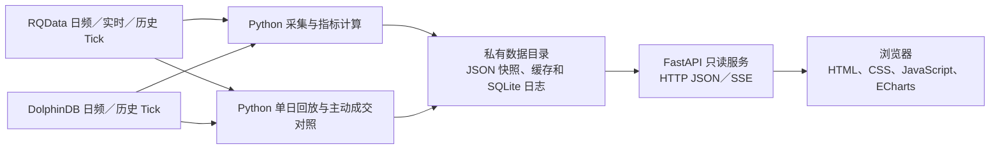

# ETF 资金与市场拥挤度观测台项目指南

此版指南基于 `dev_home` 同步 Gitee `dev_ebscn` 的代码版本 `8e0fdbe`。所有交易日期和运行时间均按北京时间理解。命令从项目根目录执行。

## 1. 功能与操作入口

| 页面与功能 | 用法与口径 |
|---|---|
| ETF 资金观测台 `/` · 盘中交易 | 对比分钟成交额、上证综指、同进度累计成交，以及放量日与常态日的分钟结构。查看最新行情时间与延时，确认当前为实盘或回放。 |
| ETF 资金观测台 · 放量信号 | 查历史放量日成交额与净申购估算。该模块按日看历史，盘中新事件到「ETF 异动雷达」查看。 |
| ETF 资金观测台 · 历史资金 | 查看 20 只核心 ETF 的日度净申购估算与上证综指，以及 12 类宽基的申赎、合计、日末规模和折溢价。通过时间窗口或自选日期查看区间。 |
| ETF 资金观测台 · 盘中主动成交与日末净申赎 | 在「历史资金」选择起止日期、ETF 和确认放量状态，切换每日明细、按标的汇总、按日期汇总。查看主动买、主动卖、日末净申赎及主动买减净申赎的差额。 |
| ETF 异动雷达 | 查看篮子双基准、指数维度当日确认放量、单只 ETF 信号与期货同窗证据。可选择实盘或按日期和时点回放，调整显示列和期货金额口径，按需启用语音。 |
| 市场拥挤度观测台 `/crowding` | 查看沪深 A 股前 1%／3%／5% 成交占比、沪深 300／中证 1000 大小盘风格、指数行业集中度、公募季度重仓，以及融资与估值指标。各子模块有独立快照和更新节奏。 |

单只 ETF 放量默认比较过去 20／60 日同窗成交额的 P75，结合历史全天成交额参考和其他证据。`amount_window_quantile` 在 `config/etf-burst.json` 中可调。页面上用于篮子观察的阈值和逐只 ETF 采集规则是两套配置。确认窗口金额按标的与分钟去重。期货同窗按实际合约期限展示主动买卖成交额、净增仓名义额、卖侧增仓代理额等口径。多个 ETF 引用同一期货合约窗口时，跨 ETF 汇总须先按合约和时间去重。盘口判向、期货代理额与 ETF 净申赎用于对照，无法从中识别交易主体或还原实际持仓。详见 [ETF 雷达](../reference/radar.md)、[Tick 与期货口径](../reference/tick-driver.md)、[资金计算](../reference/flow-methodology.md)和[拥挤度口径](../reference/crowding.md)。

## 2. 架构与数据流



| 层 | 主要文件与职责 |
|---|---|
| 采集与数据源 | `etf_backend/collect.py` 执行日频、盘中和拥挤度采集。`provider.py`、`sources.py` 和 `ddb_replay.py` 负责行情源及回放适配。 |
| 指标与复盘 | `etf_backend/model.py` 维护行情快照和基金计算。`burst.py` 管理逐只 ETF 异动，`flow_comparison.py` 导入与更新逐标的日度对照，`scripts/replay-burst-day.py` 运行单日复盘。 |
| 服务 | `etf_backend/web.py` 提供网页、行情 API 与 SSE。网页进程按文件版本重读行情产物，采集更新后可热加载。 |
| 前端 | `src/index.html`、`src/crowding.html` 与 `src/assets/`。浏览器计算显示、处理筛选与回放控件，并渲染图表。Node 构建、旧服务及遗留部署见 [Node 路径归档](../archive/legacy-node/index.md)。 |
| 配置 | `config/basket.json` 定义 20 只核心 ETF，`config/universe.json` 定义市场标的与分类，`config/data-sources.json` 定义日频和实时源，`config/etf-burst.json` 定义逐只 ETF 监控参数。 |

### 数据源、频率与就绪判断

| 数据 | 当前实现 |
|---|---|
| ETF 日频价格、成交、份额净值、净申赎 | 默认 DDB，RQData 可选。默认源未就绪且有可用 RQData 快照时，隐式请求可回退。显式请求未就绪源返回 `409 source_not_ready`。DDB 日频视图的历史分钟参考来自 RQData 分钟快照，两个源的日频字段分开读取。 |
| ETF 和股指期货实时报价 | RQData 上游推送。浏览器优先通过 SSE 读取约每秒合并一次的报价更新，连接失败时轮询缓存。实时源与日频源独立选择。 |
| 正式异动和秒级候选 | 默认 `minute_driver=provider`，正式异动由供应商分钟 bar 驱动。Tick 可提前生成候选和按配置聚合分钟。30／60 秒持续性候选需要目标日前历史 Tick 基准并达到覆盖门槛。 |
| 历史单日 ETF／期货 Tick | `day-replay` 可选 `rqdata` 或 `ddb`。DDB 模式按行情时钟重建。即便使用 Tick 重建相同信号，重放历史行情时间也无法推算生产接收延迟。 |
| 市场拥挤度 | 独立使用 RQData；行业与融资、市值等日频数据按归档更新，公募重仓按季披露。住户存款等缺项保留 Wind API 数据位置。 |
| 主动成交对照 | 独立读私有快照。既可导入专题回放 CSV，也可从单日回放档案和 DDB 盘口构建。日末净申赎使用份额变化乘原始单位净值的估算，按交易日和份额折算规则对齐。 |

已回放且无确认放量的标的日，盘中金额为零。DDB 盘口判向只累计有方向的成交额，灰区及缺少有效买一、卖一的成交不进入主动买卖金额。有确认放量却没有可判向成交时，当前生成器仍可能输出买卖均为零，应同时看窗口总额。缺净值或份额时净申赎留空。主动成交对照的汇总使用三个主字段均有效的配对行，明细同时可见部分有效记录。

常用端点为 `/api/health`、`/api/sources`、`/api/board`、`/api/live`、`/api/live/stream`、`/api/etf-burst`、`/api/etf-burst/stream`、`/api/etf-flow-comparison`、`/api/crowding`。接口字段与错误状态见 [HTTP API](../reference/http-api.md)和[数据契约](../reference/data-contract.md)。

## 3. 安装、启动与检查

Windows 在 PowerShell 进入项目根目录。以同一个 Python 环境安装依赖和启动应用，必要时设置 `ETF_BACKEND_PYTHON` 指向解释器。随后可在无需行情权限的演示模式确认服务启动。

```powershell
python -m pip install -r requirements-python.txt
$env:DATA_MODE = 'demo'
$env:ENABLE_RADAR = '1'
$env:PORT = '8080'
& .\scripts\python-backend.ps1 web
```

浏览器访问 <http://127.0.0.1:8080/>，`Ctrl+C` 停止。演示主要覆盖 ETF 页面，拥挤度需要独立数据。端口占用时，使用自己已有的服务，或设置 `$env:PORT = '8086'` 启动另一实例。

真实数据模式按 [配置参考](../getting-started/configuration.md)设置数据目录和行情凭据。使用 DDB 时在相同采集环境安装 `dolphindb` SDK，配置 `DDB_HOST`、`DDB_PORT`、`DDB_USER`、`DDB_PASSWORD`。已有有效日频快照可直接使用。首次从有权限的源构建，其后按需追加 `--recent`。以下用 RQData 举例，构建 DDB 日频将 `--source=rqdata` 换成 `--source=ddb`。

```powershell
# 终端一，已有有效快照时可跳过首次构建
& .\scripts\python-backend.ps1 -Mode history -Arguments @('--source=rqdata')
$env:DATA_MODE = 'live'
$env:ENABLE_RADAR = '1'
& .\scripts\python-backend.ps1 web

# 终端二，实盘采集器
& .\scripts\python-backend.ps1 -Mode live -Arguments @('--watch')
```

按需执行 `& .\scripts\python-backend.ps1 crowding` 及 `--crowding-module=industry`、`funds`、`financing` 的子模块采集，命令见[运行手册](../operations/runbook.md)。Linux 可直接运行 `uvicorn etf_backend.web:app --host 127.0.0.1 --port 8080` 和 `python -m etf_backend.collect live --watch`，并由部署环境注入配置。

| 观察现象 | 优先核对 |
|---|---|
| `/api/board` 返回 409 | `/api/sources` 的行情日期、份额日期和未就绪原因，实际 `source` 参数与日频快照。 |
| `/api/live` 返回 503 | 当前交易时段、交易日期、采集器运行和缓存路径。盘前等待当日行情属于正常状态。 |
| 雷达有数据但日度主动成交对照为空 | 单独请求 `/api/etf-flow-comparison`，检查独立快照和所选日期。 |
| 拥挤度个别图表没有数值 | 核对对应模块快照、数据权限、报告期或披露日期。住户存款等预留项允许空值。 |
| 数据不更新 | 先核对行情时间和文件更新时间，再检查采集日志或上游权限。仅数据文件更新时网页支持热加载。 |

## 4. 复盘、更新与落库

**复盘 ETF 和股指期货同窗异动**。使用以下命令构建独立归档，换成 `--source=ddb` 可走 DDB。脚本会检查并复用兼容的目标日前基准，或根据前 60 个交易日历史补建。初次可通过 `--symbols 510050.SH` 缩小范围。已下载完整输入可用 `--input-dir` 和 `--offline` 在新目录复算。

```powershell
& .\scripts\python-backend.ps1 -Mode day-replay -Arguments @(
    '--day=2026-11-20', '--source=rqdata', '--out=.local/day-replay-20261120')

# 在新的 PowerShell 终端运行独立网页
$env:ETF_BURST_DIR = (Resolve-Path .local/day-replay-20261120).Path
$env:DATA_MODE = 'live'
$env:ENABLE_RADAR = '1'
$env:PORT = '8086'
& .\scripts\python-backend.ps1 web
```

在雷达选择日期和时点，设为 `15:00` 可查看该日净申赎估算及覆盖率。手动单日复盘产物包括 `replay/<日期>.json`、`journals/<日期>.sqlite3`、基准及输入缓存。若仅查看历史分时，使用 `live --replay=<日期> --cache=<独立缓存路径>` 加 `web -ReplayCache <同一路径>`。具体命令、校验顺序与专题 CSV 导入见 [单日复盘](../operations/runbook.md#34-单日-etf-异动复盘)及[日度对照](../operations/runbook.md#35-日度主动成交与申赎对照)。

| 存储 | 更新与保留 |
|---|---|
| `data/private/rqdata-seed.json` 与 `ddb-seed.json` | 首次全量生成。随后以 `history --recent` 增量更新；源和公式变化时按完整快照重建。 |
| `data/private/rqdata-live.json` | 实盘共享缓存，采集器覆盖写入。 |
| `data/private/rqdata-crowding*.json` | 分模块保留市场、行业、公募、融资快照。 |
| `data/private/etf-burst/` | 记载实时事件、日归档、回放、分钟与秒级基准，以及按日 SQLite 日志。 |
| `data/private/flow-replay/` 与 `etf-flow-comparison.json` | 前者存夜间回放 JSON，另复制一份给雷达网页。后者存日度主动成交、净申赎和配对数据，由独立命令合并。 |

目标部署机可在交易日配置开盘前启动、09:10 日频与拥挤度更新、12:30 补采和 22:00 DDB 回放。`update-flow-replay.ps1` 生成并复制回放 JSON。`update-daily-all.ps1` 通过 `flow-comparison --merge` 合并上一交易日。如果部署机希望在 22:00 份额净值齐全后尝试当日合并，可把 `update-flow-comparison.ps1 -Day <日期>` 配在夜间回放之后。合并需要可读取 DDB 盘口，且全部核心 ETF 的净申赎有效。需要保留单日复盘的 SQLite 和 Tick 输入时，直接执行 `day-replay` 并保存独立输出目录。定时配置与备份见 [数据管线](../operations/data-pipeline.md)和[备份与迁移](../operations/backup-and-upgrade.md)。

## 5. 部署到另一台电脑或腾讯云

1. 迁移项目源码和依赖清单，在目标机创建 Python 环境。按授权迁移日频、拥挤度、复盘和主动成交对照快照，在目标系统重新配置行情账号与文件路径。
2. 网页与采集器使用同一份数据目录，分别启动。Windows Server 可用任务计划程序，Linux 可用 systemd，腾讯云 CVM 可任选其一。部署节奏由目标机管理员配置。
3. 外网入口使用 HTTPS 反向代理、访问控制与行情授权范围内的接口。网页进程只需快照读取权限。测试 SSE 时检查代理关闭对应路径的缓冲。
4. 分开验收日频、实时、雷达、复盘、主动成交对照和拥挤度。先以快照与离线回放验证口径，再在交易时段测实时负载、时延和断线恢复。

见 [部署方式](../operations/deployment.md)、[网络配置](../operations/network-security.md)及[测试手册](../development/testing.md)。

## 6. 全 Python 改造的可行性

**统一采集、指标、回放和 HTTP 服务到 Python 已经具备基础。** 对内部研究页面，也可以用 Dash 等 Python 框架编写布局和回调，复用现有 FastAPI 接口、JSON 契约与 SQLite 复盘日志。浏览器仍执行组件自带的 JavaScript。高频回调有序列化、网络往返和并发开销，框架提供的客户端回调或持久连接可减少其中一部分。参见 [Dash 客户端回调](https://dash.plotly.com/clientside-callbacks)与[实时更新](https://dash.plotly.com/live-updates)。

如准备试点，建议选「ETF 盘中主动成交与日末净申赎」做 Python 界面，复用现有 API，对相同日期和标的逐项核对金额、缺数和汇总。保留现有盘中网页作为性能对照。评估实时页面时，用同一段 Tick 输入和同一并发量比较行情到界面的 P95 延迟、筛选响应、带宽、CPU、内存和断线恢复。Tick 进入采集和计算的速度与页面重绘频率应分别控制。

若目标包括微信小程序，建议共享 Python 后端和只读 HTTPS API，小程序使用自己的展示层。由服务端提供可筛选的日频和回放结果，再按小程序客户端能力决定盘中推送接入方式。Web 端现有 SSE、浏览器语音和图表交互应分项验收。当前提交保留现有前后端，迁移性能需以试点对比实测为准。
